# DataChain Rust 流程说明(基于现有代码)

> 图片与源定义(Mermaid)。重新生成(需 node):
> `npx -y @mermaid-js/mermaid-cli@11.4.2 -i docs/<名>.mmd -o docs/<名>.png -b white -s 3 -p docs/.puppeteer.json`
>
> - **全节点简略图**:`docs/FLOW-0-simple.png`(源 `FLOW-0-simple.mmd`)——覆盖全链路关键节点、数据与计算，不展示接口或调用细节
> - **业务简略分图**：认证(`FLOW-S1-auth`)、数据上链(`FLOW-S2-data`)、链上身份(`FLOW-S3-identity`)、存储恢复(`FLOW-S4-storage`)、版本与汇总(`FLOW-S5-version-aggregation`)、对外传播与锚定(`FLOW-S6-distribution`)、可验证语义目录(`FLOW-S7-catalog`)——覆盖各节点业务流转，不展示接口、字段、SQL 或内部调用
> - 架构总览:`docs/FLOW.png`(源 `FLOW.mmd`)——只画模块与数据流向
> - 链路 A 元数据:`docs/FLOW-A-metadata.png`(源 `FLOW-A-metadata.mmd`)——带字段/计算
> - 链路 B 链上身份 L1:`docs/FLOW-B-identity.png`(源 `FLOW-B-identity.mmd`)
> - 链路 C 数据锚定 R5:`docs/FLOW-C-anchor.png`(源 `FLOW-C-anchor.mmd`)

## 全节点简略流程

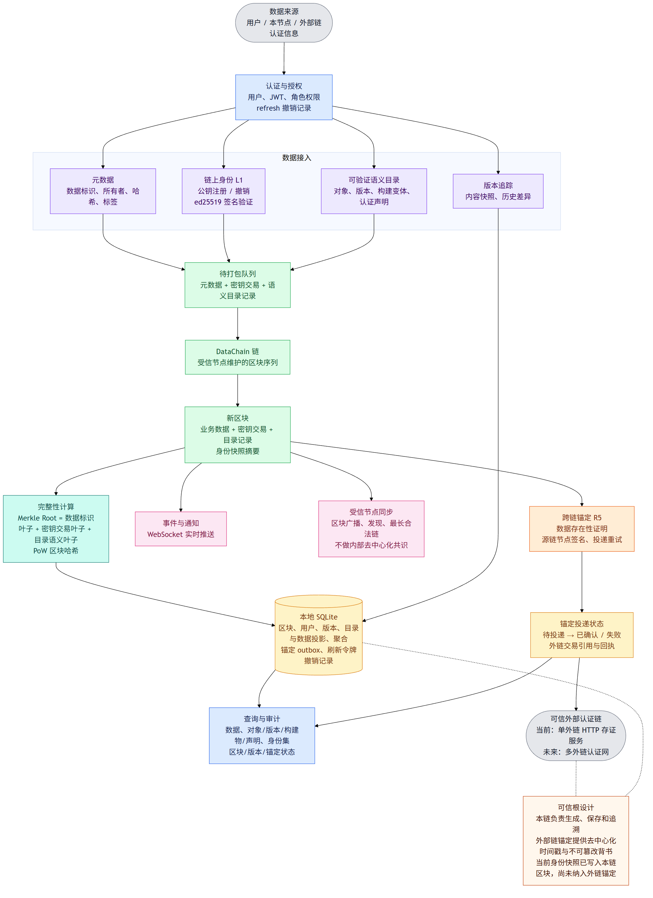

## 业务简略分图

> 以下六张图覆盖当前已实现的全部主要节点。它们只保留业务职责、状态和结果，
> 不包含 API 路径、请求字段、数据库语句、签名内容或内部函数调用。

### 认证与授权

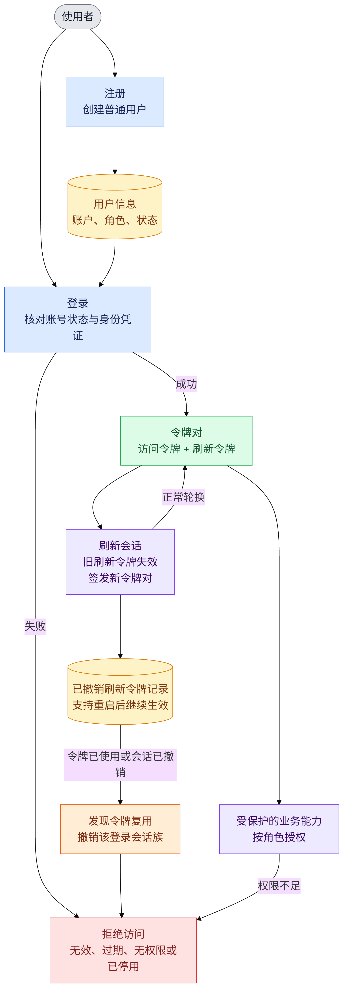

### 数据上链与查询

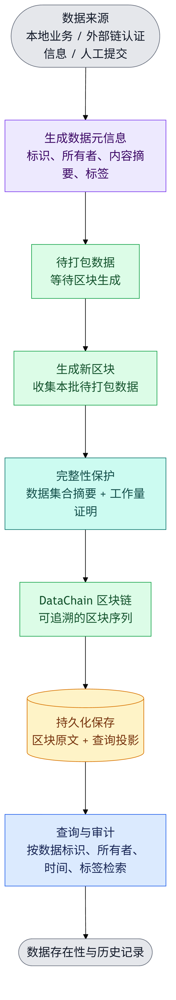

### 链上身份与密钥状态

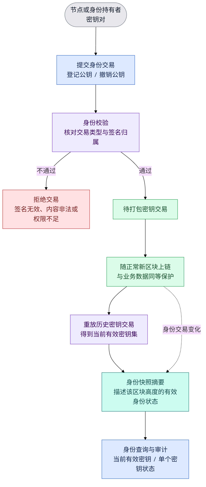

### 存储、恢复与查询投影

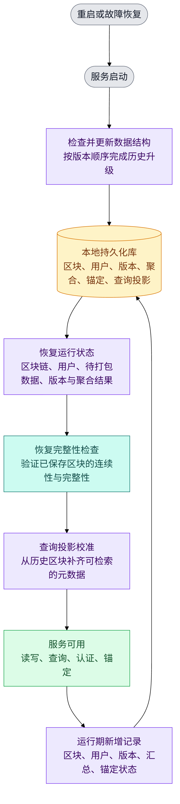

### 版本追踪与数据汇总

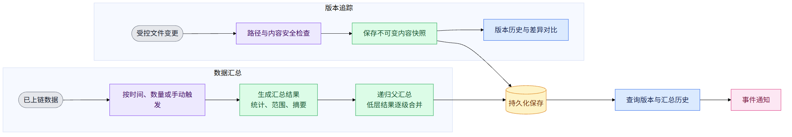

### 通知、节点同步与外部认证锚定

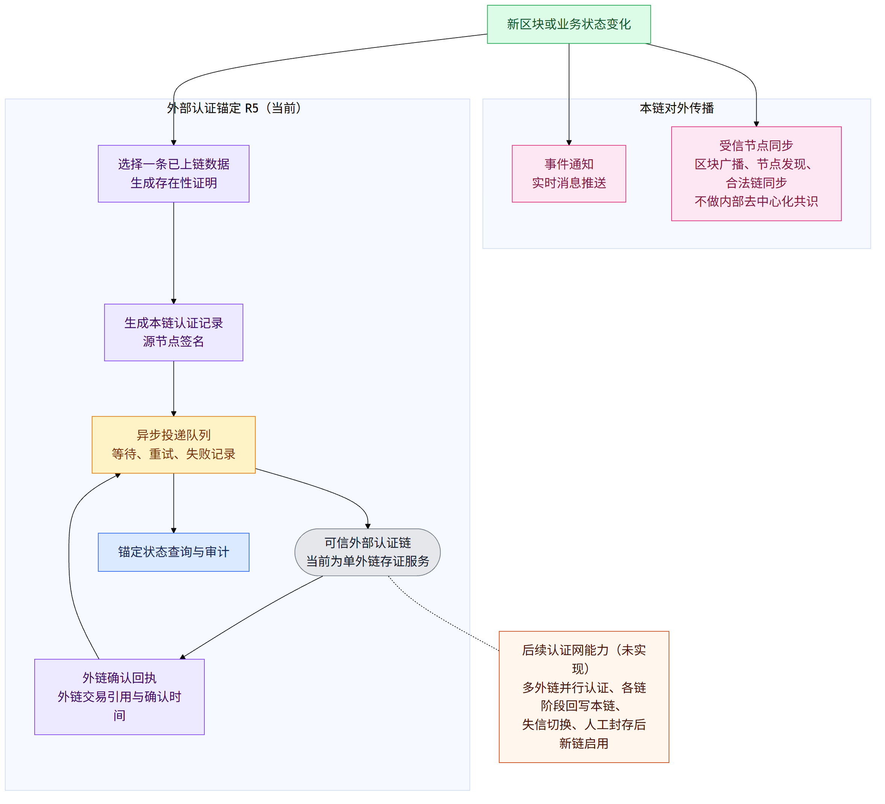

### 可验证语义目录与认证声明

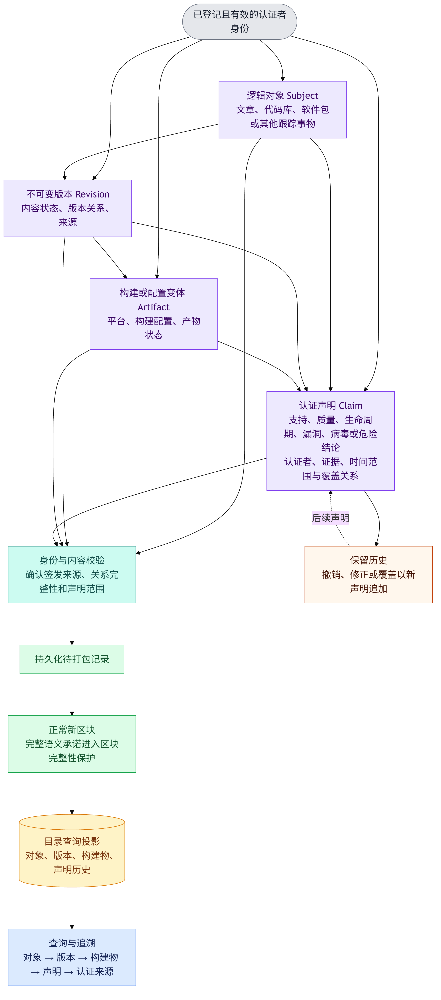

## 技术细节图

> 以下内容保留接口、字段、计算和调用信息，适合实现或审计时查阅。

### 架构总览

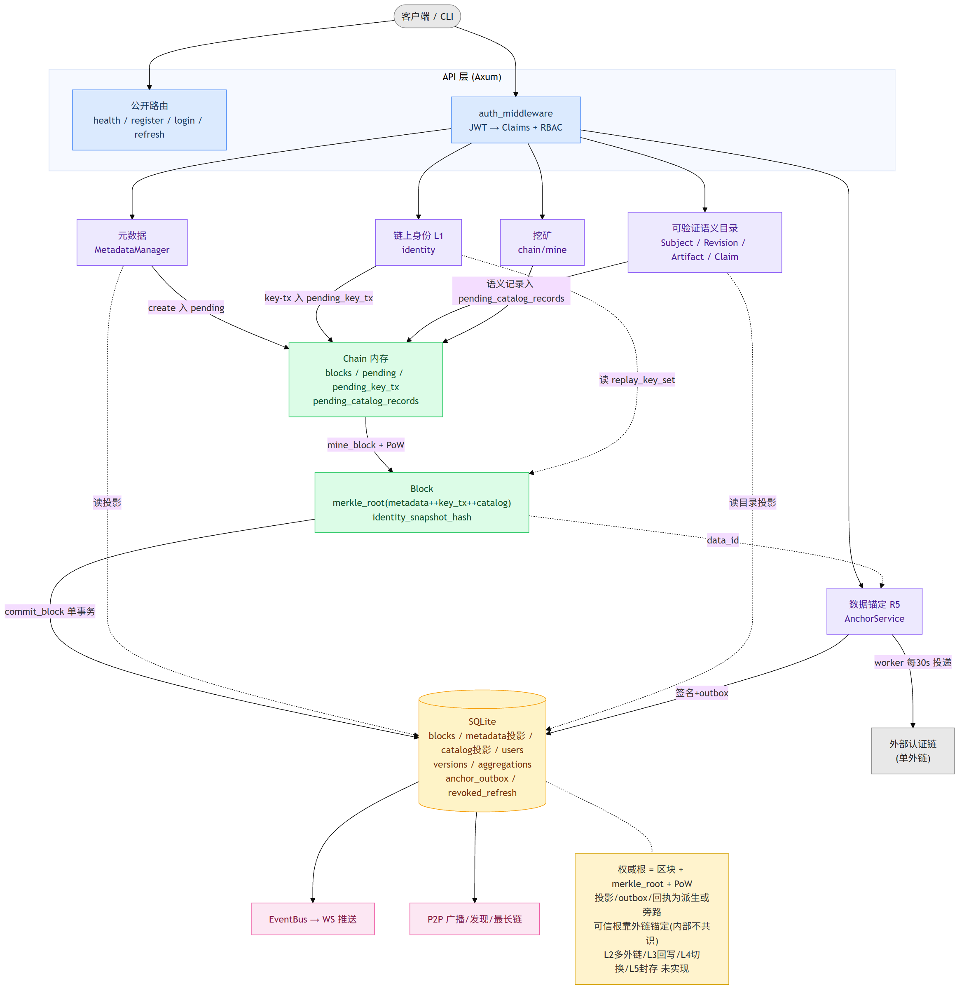

### 链路 A:元数据

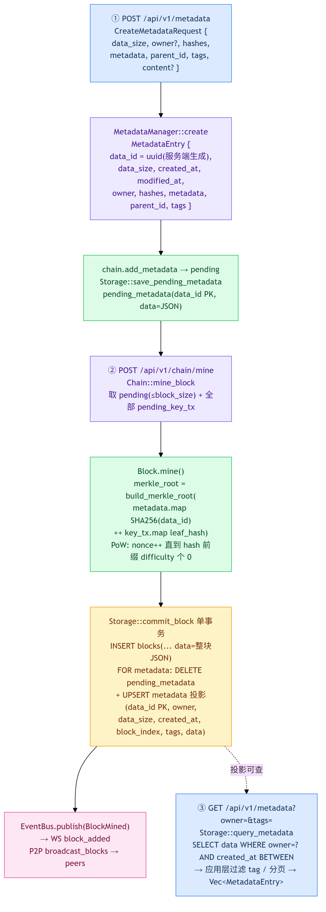

### 链路 B:链上身份 L1

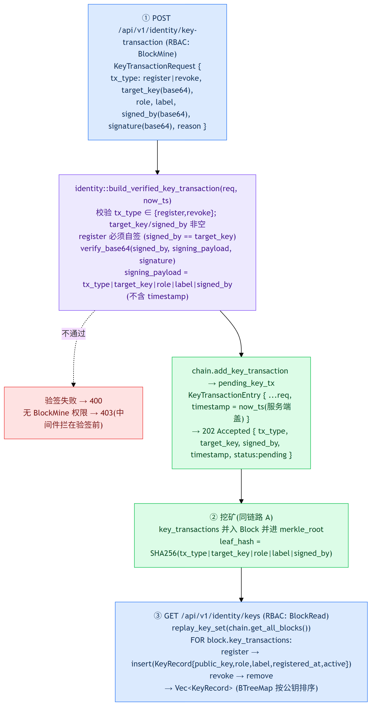

### 链路 C:数据锚定 R5

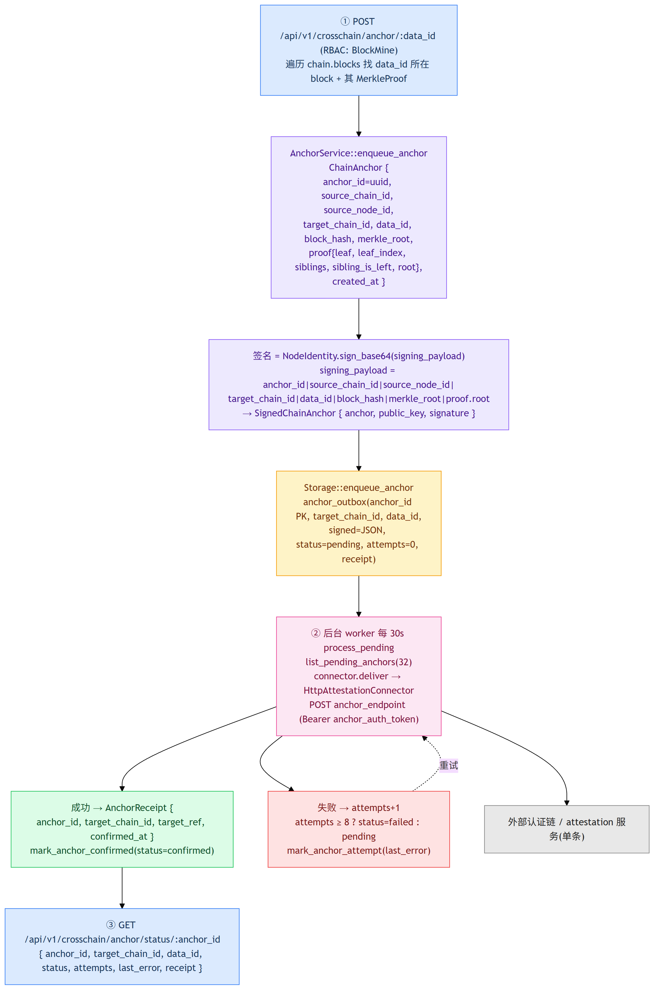

> 最后核实:2026-10-18,对应最新代码提交 `d97cd94`(可验证语义目录与完整 Claim 承诺基础)。
> 本文仅描述**已实现并经 247 验证**的行为;未实现的 L2(多外链锚定)/L3(锚定进展回写)/
> L4(失信切换)/L5(封存重启) 不在此图内,见 `IMPLEMENTATION_STATUS.md` 第四节后续建议。
> 状态变化时需按 `.kiro/steering/doc-maintenance.md` 同步更新本文与核实提交。

## 一、模块/调用级完整流程图

```
                          ┌─────────────────────────────────────────────┐
                          │                客户端 / CLI                   │
                          └───────────────────┬─────────────────────────┘
                                              │ HTTP (Axum Router)
                 ┌────────────────────────────┼────────────────────────────┐
                 │ 公开路由           保护路由(auth_middleware: JWT+RBAC)     │
                 │ /health            /api/v1/** (除 auth/register,login)    │
                 │ /auth/register                                           │
                 │ /auth/login        ──► 校验 Bearer JWT → Claims          │
                 │ /auth/refresh          → required_permission(method,path)│
                 └────────────────────────────┬────────────────────────────┘
                                              │
         ┌──────────────┬──────────────┬──────┴────────┬───────────────┬──────────────┐
         ▼              ▼              ▼               ▼               ▼              ▼
   [认证 auth]     [元数据 metadata] [区块链 chain]   [版本 versioning] [跨链 crosschain] [身份 identity/L1]
   register/        create ─┐      mine_block        track_version    anchor/:data_id   key-transaction
   login/refresh    query   │      get_blocks/info   get_diff/history  anchor/status     /keys[/:pk]
   (AuthService     get     │      validate          (VersionTracker   identity          (重放区块
    +Storage:       (Metadata│                        +ContentStorage)  (AnchorService)    key_transactions)
    revoked_refresh Manager) │
    _tokens 表)     ▼        │           ┌─────────────────────────────┐
                 读:投影表    │           │        Chain (内存)           │
                 metadata ◄──┘           │  blocks: Vec<Block>          │
                 写:入 chain pending      │  pending: Vec<MetadataEntry> │
                             └──────────►│  pending_key_tx: Vec<KeyTx>  │
                                         └──────────────┬──────────────┘
                                                        │ mine_block()
                                                        │ = pending(metadata)+pending_key_tx
                                                        │   → new Block → mine()(PoW)
                                                        ▼
                                         ┌─────────────────────────────┐
                                         │  Block (打包+PoW)            │
                                         │  merkle_root=metadata叶子    │
                                         │    ++ key_tx 叶子            │
                                         │  identity_snapshot_hash(挖后)│
                                         └──────────────┬──────────────┘
                                                        │ Storage::commit_block
                                                        │ (单事务)
                                                        ▼
                    ┌───────────────────────────────────────────────────────────┐
                    │                   SQLite (Storage, SQLx)                    │
                    │  同事务: INSERT blocks  +  DELETE pending_metadata          │
                    │          +  UPSERT metadata(投影表)                         │
                    │  其他表: users / versions / aggregations / schema_migrations│
                    │          anchor_outbox / revoked_refresh_tokens            │
                    └───────────────────────────────────────────────────────────┘
                                                        │
              ┌─────────────────────────────────────────┼─────────────────────────────┐
              ▼ 事件                                      ▼ 广播                         ▼ 跨链
   ┌────────────────────┐              ┌──────────────────────────┐      ┌──────────────────────────┐
   │ EventBus→WsHub      │              │ P2PService (单向出)       │      │ AnchorService 后台 worker │
   │ WebSocket 推送      │              │ broadcast_blocks →peers  │      │ 每30s process_pending    │
   │ /ws /ws/chain 等    │              │ exchange_peers 发现      │      │ outbox→connector.deliver │
   │ (全量广播,无频道过滤)│              │ sync_peer 最长链替换      │      │ →单外链→AnchorReceipt    │
   └────────────────────┘              └──────────────────────────┘      └──────────────────────────┘
```

## 二、带数据字段的详细流程图

### 链路 A:元数据创建 → 挖矿上链 → 查询

```
① POST /api/v1/metadata                      ② POST /api/v1/chain/mine
  CreateMetadataRequest {                       │
    data_size:i64, owner:Option<String>,        │ Chain::mine_block():
    hashes:Map<String,String>,                  │  取 pending(≤block_size) + 全部 pending_key_tx
    metadata:Map<String,Value>,                 │  → Block{ index, timestamp, previous_hash,
    parent_id:Option, tags:Vec,                  │          metadata_list:Vec<MetadataEntry>,
    content:Option<Vec<u8>>(skip) }             │          key_transactions:Vec<KeyTx> }
        │ MetadataManager::create                │  Block.mine():
        ▼                                         │    merkle_root = build_merkle_root(
  MetadataEntry {                                 │       metadata_list.map(SHA256(data_id))
    data_id: uuid(服务端生成),                     │       ++ key_transactions.map(leaf_hash))
    data_size, created_at, modified_at,          │    PoW: nonce++ 直到 hash 前缀 difficulty 个0
    owner, hashes, metadata, parent_id, tags }   │    hash = canonical_block_hash(index,ts,
        │ chain.add_metadata → pending            │       prev_hash,merkle_root,nonce,difficulty)
        │                                         │  挖后: identity_snapshot_hash =
  Storage::save_pending_metadata                  │     compute_identity_snapshot_hash(replay_key_set(all))
    pending_metadata(data_id PK, data=JSON)       ▼
        │                                    Storage::commit_block(block) 单事务:
  EventBus.publish(MetadataCreated)            INSERT blocks(block_index,timestamp,previous_hash,
        ▼                                            merkle_root,nonce,difficulty,hash,data=整块JSON)
   WS 推 metadata_added                          FOR entry IN metadata_list:
                                                   DELETE pending_metadata WHERE data_id=?
③ GET /api/v1/metadata?owner=&tags=               UPSERT metadata(data_id PK, owner, data_size,
   MetadataManager::query → Storage::query_metadata   created_at, block_index, tags=JSON, data=JSON)
   SELECT data FROM metadata                        │
     WHERE owner=? AND created_at BETWEEN ?          ▼
   → 应用层再过滤 tag/分页                      EventBus.publish(BlockMined) → WS block_added
   → Vec<MetadataEntry>                        P2P: tokio::spawn broadcast_blocks([block]) → peers
```

### 链路 B:链上身份(L1) —— 注册/撤销 → 挖矿 → 重放查询

```
① POST /api/v1/identity/key-transaction (RBAC: BlockMine)
   KeyTransactionRequest {
     tx_type:"register"|"revoke", target_key(base64公钥),
     role, label, signed_by(base64公钥), signature(base64), reason }
        │ identity::build_verified_key_transaction(req, now_ts)
        │   校验 tx_type∈{register,revoke}; target_key/signed_by 非空;
        │   register 必须自签(signed_by==target_key);
        │   NodeIdentity::verify_base64(signed_by, signing_payload, signature)
        │   signing_payload = "tx_type|target_key|role|label|signed_by" (不含 timestamp)
        ▼ 通过 → KeyTransactionEntry{ ...req字段, timestamp=now_ts(服务端盖) }
   chain.add_key_transaction → pending_key_tx           ② 挖矿(同链路A②)
        │ 失败: 验签不过→400 / 无权限→403(中间件拦在验签前)   key_transactions 并入 Block
        ▼                                                 进 merkle_root(leaf_hash=SHA256(
   202 Accepted {tx_type,target_key,signed_by,              "tx_type|target_key|role|label|signed_by"))
        timestamp, status:"pending"}

③ GET /api/v1/identity/keys (RBAC: BlockRead)
   identity::replay_key_set(chain.get_all_blocks()):
     FOR block IN blocks: FOR tx IN block.key_transactions:
       register → set.insert(target_key → KeyRecord{public_key,role,label,registered_at,status:"active"})
       revoke   → set.remove(target_key)
   → Vec<KeyRecord>  (BTreeMap 按公钥排序)
```

### 链路 C:数据锚定(R5,现有单外链) —— 发起 → outbox → worker 投递 → 回执

```
① POST /api/v1/crosschain/anchor/:data_id (RBAC: BlockMine)
   遍历 chain.blocks 找 data_id 所在 block + 其在该块的 MerkleProof
        │ AnchorService::enqueue_anchor(target_chain_id, data_id, block_hash, merkle_root, proof)
        ▼
   ChainAnchor {
     anchor_id:uuid, source_chain_id, source_node_id,
     target_chain_id, data_id, block_hash, merkle_root,
     proof:MerkleProof{leaf,leaf_index,siblings,sibling_is_left,root},
     created_at }
        │ signature = NodeIdentity.sign_base64(signing_payload)
        │ signing_payload = "anchor_id|source_chain_id|source_node_id|
        │                    target_chain_id|data_id|block_hash|merkle_root|proof.root"
        ▼
   SignedChainAnchor { anchor, public_key, signature }
        │ Storage::enqueue_anchor
        ▼
   anchor_outbox(anchor_id PK, target_chain_id, data_id, signed=JSON,
                 status='pending', attempts=0, last_error, receipt, created_at, updated_at)

② 后台 worker (start_worker, 每 30s)  AnchorService::process_pending:
   list_pending_anchors(32)
   FOR entry: connector.deliver(signed)   ← HttpAttestationConnector
     POST anchor_endpoint (Bearer anchor_auth_token) body=SignedChainAnchor
       成功 → AnchorReceipt{anchor_id,target_chain_id,target_ref,confirmed_at}
              → mark_anchor_confirmed(status='confirmed', receipt=JSON)
       失败 → attempts+1; attempts≥8 ? status='failed' : 'pending'
              → mark_anchor_attempt(last_error)

③ GET /api/v1/crosschain/anchor/status/:anchor_id
   Storage::get_anchor → {anchor_id,target_chain_id,data_id,status,attempts,last_error,receipt}
```

## 三、关键事实(均来自现有代码)

- **merkle_root 只覆盖本区块**:叶子 = 本区块 metadata 的 `SHA256(data_id)` ++ 本区块 key_tx 的
  `leaf_hash`;两两配对(奇数自配对)建树。不跨区块。
- **identity_snapshot_hash 不进 PoW 哈希**:挖矿后由 `replay_key_set` 得当前有效密钥集再
  `compute_identity_snapshot_hash` 算出,作为派生字段写入区块头;**也不进任何锚定 payload**
  (现有锚定载荷 ChainAnchor 不含它)。
- **数据锚定按单条 data_id**:经**单个** `HttpAttestationConnector` 投**单条**外链;
  无多外链、无"锚定进展回写本链"(L2/L3 待做)。
- **metadata 查询走投影表**(backlog #5):`metadata` 表是只读查询投影,
  commit_block 同事务 upsert + 启动/CLI 代码级回填;权威源仍是区块 `metadata_list`。
- **投影表 / outbox / 回执都是派生或旁路**;区块 + merkle_root + PoW 是唯一权威。
- **pending_key_tx 仅内存**(L1 最小版):进程重启丢失未打包的密钥交易,register/revoke 幂等可重提。

## 四、权威性与可信根(设计基调)

DataChain 内部**有意不做拜占庭共识**(受信节点 + 最长合法链)。可信根来自把数据 merkle_root
与身份快照**锚定到外部去中心化公共链**,由外链不可篡改性背书。外链→本链的认证走正常上链路径
(无特殊逻辑)。当前已实现 L0(R5 单链锚定)+L1(链上身份);多外链互锚认证网(L2-L5)为后续。
